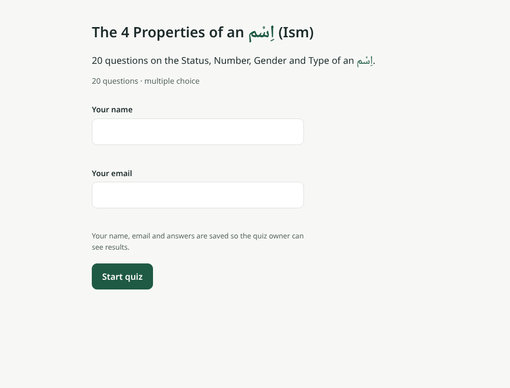
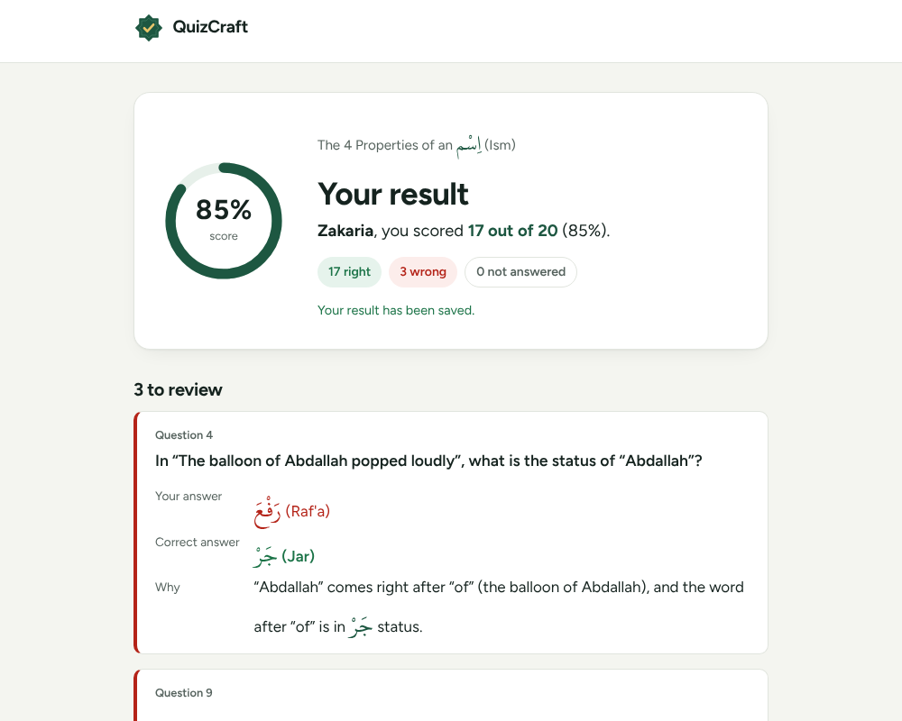
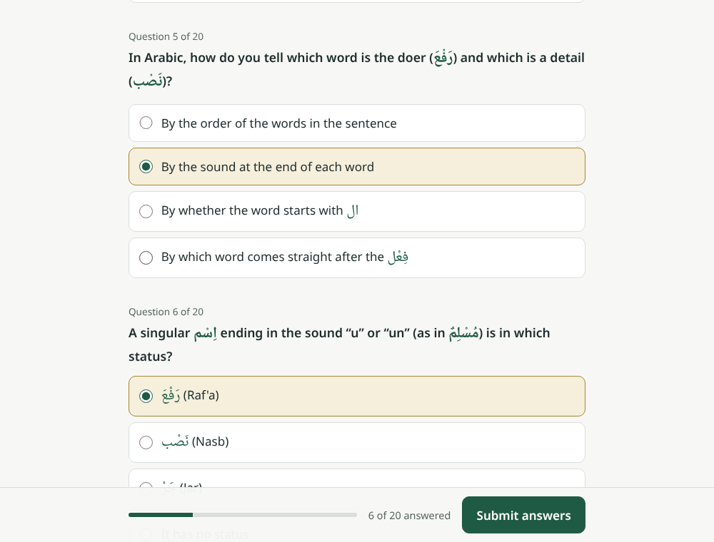
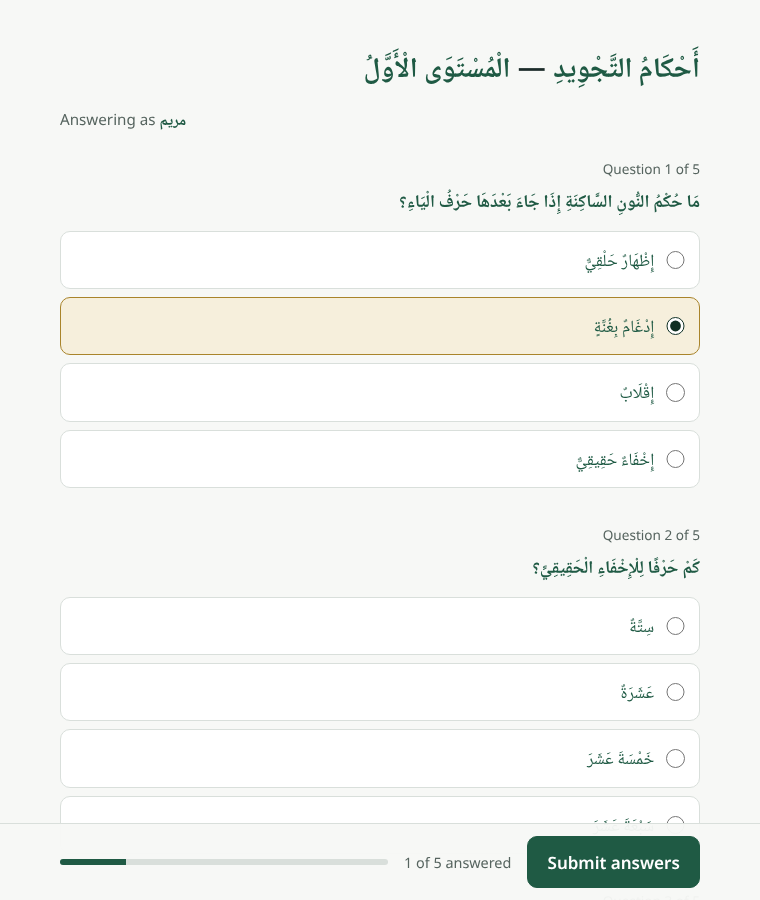
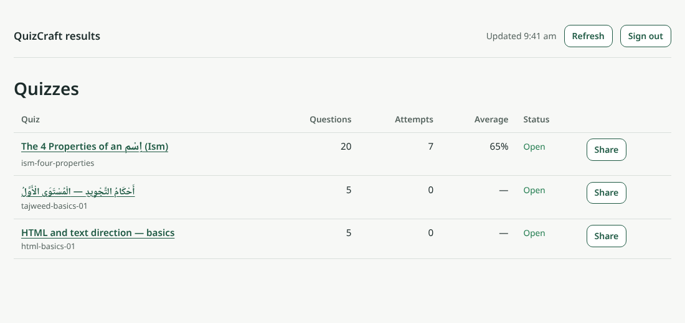
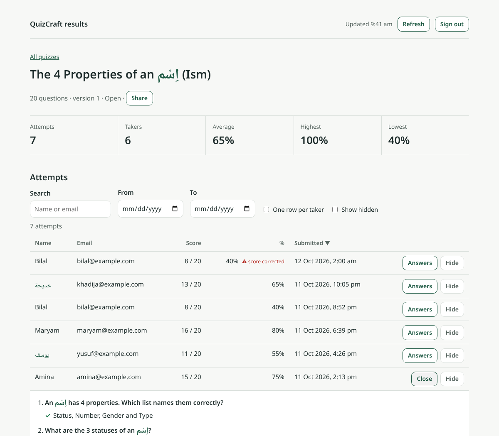

# QuizCraft

A static quiz website. Quizzes are JSON files in this repo (Arabic, English or mixed). Anyone with a quiz's public link enters their name and email, takes the quiz, and sees their score, the correct answers and an explanation for each mistake. Every attempt is saved as a JSON record in Firebase Firestore. A password‑protected dashboard shows all attempts, statistics, share links, and JSON/CSV downloads.

> **Build status:** all phases complete, see [`docs/PROGRESS.md`](docs/PROGRESS.md). To go live, follow [Deployment](#15-deployment).

## 1. Product overview

QuizCraft has two audiences:

- **Quiz takers** open a shared link, enter name and email, answer multiple‑choice questions and see their result on screen, with the correct answer and an explanation for every mistake.
- **Quiz owners** add quizzes as JSON files (written with Claude Code from source content) and see every attempt in a password‑protected dashboard.

There is no server of our own: the site is static files on Render, attempts go to Firebase Firestore, and the dashboard password is checked by Firebase Authentication.

| Taking a quiz                                                       | Result and review                                                        |
| ------------------------------------------------------------------- | ------------------------------------------------------------------------ |
|   |  |
|  |      |

| Dashboard: quizzes                                                      | Dashboard: one quiz                                                                     |
| ----------------------------------------------------------------------- | --------------------------------------------------------------------------------------- |
|  |  |

## 2. Features

**For quiz takers** (`/q/<quiz-id>`)

- Enter name and email, then answer all questions on one page (one choice per question).
- A progress bar shows how many questions are answered. Submitting with gaps shows which questions are unanswered and asks to go back or submit anyway (unanswered counts as wrong).
- The result screen shows the score (e.g. “18 out of 20 (90%)”) and, for every wrong or unanswered question, your answer, the correct answer and why it is correct. A perfect score gets a short congratulation. “Take the quiz again” starts over with the same name and email.
- Clear messages for a mistyped link (“Quiz not found”), a closed quiz, or a loading problem.
- Every submission is saved to Firestore as one JSON record. A line under the score says “Your result has been saved.” If the taker is offline, the attempt is kept in the browser and sent automatically next time a quiz page opens; the result screen never waits for saving.

**For quiz owners** (`/dashboard`)

- Sign in with the dashboard password (checked by Firebase; the session ends when the browser closes).
- **Quiz list:** every published quiz with its number of questions and attempts, average score and status (Open / Closed / Removed), plus a **Share** button that copies the public link (“Link copied”; if the browser blocks copying, the link is shown selected).
- **Quiz page:** attempts, takers, average, highest and lowest score; a table of every attempt (name, email, score, %, time) with search by name or email, date range, sorting, and an **Answers** view showing each question as right ✓ or wrong ✗ with the correct answer.
- **One row per taker** groups attempts by email (attempts, best and latest score).
- **Re-scoring:** every attempt is scored again from its saved answers against the quiz file. A score that doesn't match (e.g. faked in the browser) is corrected and marked “⚠ score corrected”; attempts on an older quiz version are marked “older version”.
- **How each question went:** share of right answers per question (bar with the value written beside it) and the most chosen wrong answer, to spot hard questions.
- **Hide** marks an attempt as spam in this browser (attempts can't be deleted from the site); “Show hidden” brings them back.
- **Downloads** of the attempts currently shown (after search, dates and hide filters, in table order):
  - **CSV**: one row per attempt: attempt id, quiz, name, email, stored score, re-checked score, “Score corrected” and “Older quiz version” flags, start and submit times (UTC).
  - **CSV, one row per answer**: each question with the taker's answer, the correct answer and right/wrong, using the texts from the quiz file.
  - **JSON**: the attempt records exactly as saved, with their ids and ISO dates.
  - CSVs are UTF‑8 with a BOM so Excel shows Arabic correctly, and anything a taker typed that starts with `=`, `+`, `-` or `@` is prefixed with `'` so spreadsheets don't run it as a formula.

## 3. How it works

- Render serves the static site built by Vite.
- Quiz files live in `quizzes/` and are published with the site.
- Attempts are written to Firebase Firestore; the dashboard reads them after signing in with Firebase Authentication.

Full design: [`docs/PLAN.md`](docs/PLAN.md).

## 4. Pages and routes

| URL            | Purpose                      |
| -------------- | ---------------------------- |
| `/`            | Landing page                 |
| `/q/<quiz-id>` | Take a quiz                  |
| `/dashboard`   | Results dashboard (password) |

## 5. Quiz file format

Each quiz is one file, `quizzes/<quiz-id>.json`. JSON Schema: [`schema/quiz.schema.json`](schema/quiz.schema.json).

```json
{
  "$schema": "../schema/quiz.schema.json",
  "id": "ism-four-properties",
  "version": 1,
  "active": true,
  "title": "The 4 Properties of an اِسْم (Ism)",
  "description": "Optional short description.",
  "language": "mixed",
  "createdAt": "2026-10-11",
  "source": "Optional: where the content came from",
  "questions": [
    {
      "id": "q1",
      "text": "What are the 4 properties of an اِسْم?",
      "options": [
        { "id": "a", "text": "Status, Number, Gender, Type" },
        { "id": "b", "text": "Status, Tense, Gender, Type" },
        { "id": "c", "text": "Number, Gender, Doer, Detail" },
        { "id": "d", "text": "Tense, Number, Gender, Person" }
      ],
      "correct": "a",
      "explanation": "An اِسْم has 4 properties: Status, Number, Gender and Type."
    }
  ]
}
```

Validation rules (checked by `npm test` and before every build, in `src/lib/validate.js`):

- `id`: 3–60 lowercase letters, digits or hyphens, equal to the file name.
- `version` integer ≥ 1 (increase it when you change questions of a quiz people have already taken); `active` true/false (false shows "This quiz is closed").
- `language`: `ar`, `en` or `mixed`; `createdAt`: `YYYY-MM-DD`.
- 1–100 questions; unique question ids; exactly **4 options** with unique ids and texts; `correct` is one option id; `explanation` required.
- All text NFC‑normalised with no leading/trailing spaces (Arabic diacritics are kept).
- For quizzes with 6+ questions, no more than half the correct answers may sit in the same position.

The build (`npm run build`, also `npm run quizzes`) validates every quiz, copies it to `public/quizzes/` and writes `public/quizzes/index.json` for the dashboard. One invalid quiz stops the build.

## 6. How to add or edit a quiz

**With Claude Code (recommended):** run `/add-quiz <paste content or give a file path>` and say how many questions you want. Claude Code writes the quiz file, runs the checks, commits with a changelog entry and pushes a branch. Details in `CLAUDE.md` → "How to add a quiz".

**By hand:**

1. `npm run new-quiz -- <quiz-id>` creates `quizzes/<quiz-id>.json` with TODO placeholders.
2. Fill in the title, language and questions (format above). Write Arabic with its diacritics.
3. Run `npm test` and fix any reported problem (the message names the file and question).
4. Add a bullet to `CHANGELOG.md`, commit as `quiz: add <quiz-id> (<n> questions, <language>)`, push and open a pull request.
5. After merge and deploy the quiz is live at `<site>/q/<quiz-id>`.

To edit a quiz people have already taken, increase `version`. To close a quiz, set `"active": false`.

## 7. Attempt record format

Each submission is one Firestore document at `attempts/<random-id>`:

```json
{
  "quizId": "ism-four-properties",
  "quizVersion": 1,
  "quizTitle": "The 4 Properties of an اِسْم (Ism)",
  "takerName": "Zakaria",
  "takerEmail": "someone@example.com",
  "takerEmailLower": "someone@example.com",
  "answers": [
    { "questionId": "q1", "selected": "a", "correct": true },
    { "questionId": "q2", "selected": null, "correct": false }
  ],
  "score": 18,
  "total": 20,
  "percent": 90,
  "startedAt": "2026-10-12T09:01:12.000Z",
  "submittedAt": "<server timestamp>",
  "clientId": "random id per browser",
  "userAgent": "browser string (max 200 chars)"
}
```

- The document id is a random id made in the browser before saving, so retrying a save can never create a duplicate.
- `submittedAt` is set by Firestore's clock, not the browser's.
- `selected: null` means the question was left unanswered.
- Saving: `src/lib/attempts.js` (record builder, local retry queue with back-off) and `src/lib/firebase.js` (Firestore Lite writer).

**Who can do what** (`firestore.rules`):

| Action                      | Allowed for                                                                                                                                                                     |
| --------------------------- | ------------------------------------------------------------------------------------------------------------------------------------------------------------------------------- |
| Create an attempt           | Anyone, only if every field has the right type and size, there are no extra fields, `score ≤ total`, the number of answers equals `total`, and `submittedAt` is the server time |
| Read attempts               | Only the dashboard account (its UID replaces `DASHBOARD_UID_PLACEHOLDER` at deploy)                                                                                             |
| Change or delete an attempt | Nobody (from the site)                                                                                                                                                          |
| Anything else               | Nobody                                                                                                                                                                          |

Rules cannot check each answer against the quiz, so the dashboard re‑scores every attempt from its answers (phase 4).

## 8. Dashboard guide

1. Open `<site>/dashboard` and enter the dashboard password. (It's the password of the Firebase user named in `VITE_DASHBOARD_EMAIL`; it is never stored in this repo.)
2. **Share a quiz:** press **Share** next to it and paste the link anywhere. The link is `VITE_SITE_URL/q/<quiz-id>` (or the current site address if that isn't set).
3. **See results:** click a quiz title. Use **Search**, **From/To** and the column headers to narrow and sort; press **Answers** on a row to see that taker's answers.
4. **Download:** below the table, choose **Download CSV**, **CSV, one row per answer** or **Download JSON**. Files are named `<quiz-id>-attempts-<date>.csv` / `.json` and `<quiz-id>-answers-<date>.csv`; they contain only the attempts shown, so filter first to export a subset.
5. **Refresh** reloads quizzes and attempts; **Sign out** ends the session.
6. **Change the password:** Firebase console → Authentication → Users → the dashboard user → _Reset password_ (or _Edit_). Nothing in the site needs to change.

Notes:

- The dashboard loads up to 5,000 most recent attempts and does the grouping and statistics in the browser.
- “Hide” is remembered only in the browser where you pressed it.
- If the page says “This account is not allowed to read results”, the UID in the deployed `firestore.rules` doesn't match the dashboard user (see Deployment).

## 9. Security model and limits

**What protects the data**

- **Firestore rules** (`firestore.rules`, tested in `tests/rules/`): anyone can _add_ an attempt, but only with exactly the expected fields, types and sizes and a server timestamp; nobody can change or delete attempts from the site; only the dashboard account can read them.
- **Dashboard password** is checked by Firebase Authentication. It is not in the site code, the repo, the README or the tests (tests use the emulator with a test password).
- **App Check** (optional, recommended): with `VITE_RECAPTCHA_SITE_KEY` set and enforcement turned on for Firestore in the Firebase console, Firestore only accepts requests from this site (reCAPTCHA v3, invisible to takers). This makes scripted spam much harder.
- **Security headers** (in `render.yaml`, also applied by `npm run preview`): a strict Content‑Security‑Policy (no inline scripts or styles, only this site plus the Firebase and reCAPTCHA endpoints), `X-Frame-Options: DENY`, `X-Content-Type-Options: nosniff`, `Referrer-Policy`, `Permissions-Policy` and HSTS. After every build, `scripts/check-dist.mjs` fails if a page contains anything the policy would block.
- **No HTML injection:** all quiz and taker text is inserted as text (`textContent`), never as HTML; ESLint forbids `innerHTML`, and tests feed `<script>` and `` names through every screen.
- **CSV exports** neutralise spreadsheet formulas typed by takers (see §8).
- **Limits** in the site (name ≤ 100 characters, email ≤ 254, title ≤ 200, ≤ 100 questions) match the Firestore rules; `tests/unit/limits.test.js` fails if they drift apart.
- Quiz and dashboard pages ask search engines not to index them (`noindex`).

**Known limits** (by design, because the site has no server of its own)

- **Answers are in the quiz file.** The browser downloads each quiz including its correct answers, so a technical user could find them. Use QuizCraft for practice and learning, not high‑stakes exams.
- **Scores can be faked in the browser**, but the dashboard re‑scores every attempt from its answers and shows the real score (“⚠ score corrected”).
- **Spam:** anyone with a link can submit attempts. App Check and the rules' size limits keep this reasonable; the dashboard can hide spam attempts.
- **Privacy:** taker names and emails are personal data. Only the dashboard account can read them; the quiz start page tells takers they are saved.

## 10. Arabic / RTL support

- **Fonts:** Noto Naskh Arabic (Arabic) and Noto Sans (Latin) are bundled with the site from npm (`@fontsource/*`, SIL Open Font License), so there's no external font CDN.
- **Arabic inside English:** every piece of quiz or taker text is built with `richText()` (`src/lib/render/dom.js`). Arabic runs are wrapped in `<span class="ar" lang="ar">` and shown in Naskh, slightly larger and in green, so the studied words stand out.
- **Direction by main script:** each text element gets `dir="rtl"` when most of its letters are Arabic, otherwise `dir="ltr"` (`textDirection()` in `src/lib/bidi.js`). This keeps an English explanation that starts with an Arabic word reading left to right, which `dir="auto"` would get wrong. Diacritics are ignored when counting.
- **Arabic quizzes** (`"language": "ar"`): the question list and the review list switch to right-to-left (radio buttons on the right). The interface labels and progress bar stay left to right so they read correctly.
- **Text is never altered:** quiz text must be NFC; diacritics are kept exactly. Name inputs use `dir="auto"` so typing Arabic works naturally.
- Layout uses CSS logical properties (`margin-inline-start`, `inset-inline`) so it flips cleanly.

## 11. Local development

Requirements: Node 22+ (and Java 21+ for the Firebase emulators).

```bash
npm ci
cp .env.example .env
npm run dev          # http://localhost:5173
```

Open a quiz at `http://localhost:5173/q/<quiz-id>` (the dev server rewrites `/q/*` to `quiz.html`, like Render will).

**Saving attempts locally** uses the Firebase Emulator Suite (needs Java 21+). No Firebase account is needed: the project id `demo-quizcraft` is emulator‑only.

```bash
npm run emulators    # terminal 1: Firestore on :8080, Auth on :9099
npm run dev          # terminal 2, with VITE_USE_EMULATORS=true in .env
```

Without emulators or Firebase settings the quiz still works; results show but aren't saved (“Results are not being saved on this site”).

## 12. Environment variables

See [`.env.example`](.env.example). All are build‑time (`VITE_*`) values. Firebase web config is not secret; the dashboard password is **never** stored in the repo.

| Variable                    | Required         | Purpose                                                              |
| --------------------------- | ---------------- | -------------------------------------------------------------------- |
| `VITE_FIREBASE_API_KEY`     | yes              | Firebase web config                                                  |
| `VITE_FIREBASE_AUTH_DOMAIN` | yes              | Firebase web config                                                  |
| `VITE_FIREBASE_PROJECT_ID`  | yes              | Firebase web config                                                  |
| `VITE_FIREBASE_APP_ID`      | yes              | Firebase web config                                                  |
| `VITE_DASHBOARD_EMAIL`      | yes              | Fixed account the dashboard password signs into                      |
| `VITE_RECAPTCHA_SITE_KEY`   | no (recommended) | reCAPTCHA v3 site key; turns on Firebase App Check (spam protection) |
| `VITE_SITE_URL`             | no               | Base URL for share links (defaults to current origin)                |
| `VITE_USE_EMULATORS`        | no               | `true` to use local Firebase emulators                               |
| `VITE_EMULATOR_HOST`        | no               | Emulator host (default `127.0.0.1`)                                  |

## 13. Testing

| Command                    | What it runs                                     |
| -------------------------- | ------------------------------------------------ |
| `npm test`                 | Unit tests (Vitest)                              |
| `npm run test:coverage`    | Unit tests with coverage; fails below 90 % lines |
| `npm run quizzes`          | Validate quizzes and write `public/quizzes/`     |
| `npm run new-quiz -- <id>` | Scaffold a new quiz file                         |

| Module                                | Test file                           |
| ------------------------------------- | ----------------------------------- |
| `scripts/lib/changelog.js`            | `tests/unit/changelog.test.js`      |
| `src/lib/validate.js` (+ JSON Schema) | `tests/unit/validate.test.js`       |
| `scripts/lib/quizIndex.js`            | `tests/unit/quizIndex.test.js`      |
| `scripts/lib/newQuiz.js`              | `tests/unit/newQuiz.test.js`        |
| every real quiz in `quizzes/`         | `tests/quizzes/all-quizzes.test.js` |

Test fixtures (an Arabic quiz with diacritics, an English quiz, a copy of the mixed Ism quiz, 13 deliberately invalid quizzes, and sample attempt documents including a faked score and an older-version attempt) live in `tests/fixtures/`.

Published quizzes: `ism-four-properties` (20 questions, mixed), `tajweed-basics-01` (5, Arabic) and `html-basics-01` (5, English).

**End‑to‑end tests** (`tests/e2e/`, Playwright) run the production build, with the production headers, against the Firebase Auth and Firestore emulators:

- `taker.spec.js`: take a quiz and check the score, review and the saved Firestore record; Arabic quiz right to left with the Naskh font; unanswered‑questions warning; form errors; an attempt made offline is saved on the next visit; closed quiz, wrong quiz link and 404 page; security headers present and no CSP violations.
- `dashboard.spec.js`: wrong password refused; quiz list, summary and re‑checked scores; answers view and search; Share copies the link (and the fallback when copying is blocked); CSV and JSON downloads (Arabic intact, formulas neutralised); sign‑out.

## 14. CI pipeline

GitHub Actions (`.github/workflows/ci.yml`):

- **`test`** (every push to `main` and every pull request): install (Node 22 + Java 21, emulator download cached) → lint → format check → unit tests with coverage gate (includes accessibility and contrast checks) → Firestore rules tests on the emulator → build (then the CSP check of the built pages) → Playwright end‑to‑end tests on the emulators → changelog check.
- **`deploy-rules`** (after `test`, on pushes to `main` only): fills the dashboard UID into `firestore.rules` and deploys the rules and indexes to the real Firebase project. It needs three repository secrets (see Deployment) and skips with a notice until they are set.

## 15. Deployment

Render serves the site; Firebase stores attempts and checks the dashboard password. Do these steps once, in order. Firebase and Render screens change from time to time, so menu names may differ slightly.

### Step 1: Create the Firebase project

1. Go to [console.firebase.google.com](https://console.firebase.google.com) → **Create a project** (e.g. `quizcraft`). Google Analytics is not needed.
2. **Add a web app:** on the project overview press the **Web** (`</>`) icon, give it a nickname, leave Firebase Hosting unticked, **Register app**. Keep the shown `firebaseConfig` values; you need `apiKey`, `authDomain`, `projectId` and `appId`.
3. **Firestore:** _Build → Firestore Database → Create database_. Pick a location close to your takers (e.g. `australia-southeast1`, Sydney; it can't be changed later) and **production mode**.
4. **Dashboard account:** _Build → Authentication → Get started → Sign-in method → Email/Password → Enable → Save_. Then _Users → Add user_: an email such as `dashboard@yourdomain.com` (it never receives mail) and the **dashboard password**. Copy the new user's **User UID**.
5. **Block new sign-ups** (recommended): _Authentication → Settings → User actions_, untick **Enable create (sign-up)**. Even without this, only the UID in the rules can read results.

### Step 2: Let GitHub deploy the security rules

1. In the [Google Cloud console](https://console.cloud.google.com) for the same project: _IAM & Admin → Service accounts → Create service account_ (e.g. `github-rules-deploy`). Give it the roles **Firebase Rules Admin**, **Cloud Datastore Index Admin** and **Service Usage Consumer** (the deploy first checks that the Firestore API is enabled; without this role it fails with _“Permission denied to get service [firestore.googleapis.com]”_). Then _Keys → Add key → JSON_ and download the file.
2. In GitHub: _Settings → Secrets and variables → Actions → New repository secret_, add:

| Secret                     | Value                                  |
| -------------------------- | -------------------------------------- |
| `FIREBASE_SERVICE_ACCOUNT` | the whole content of the JSON key file |
| `FIREBASE_PROJECT_ID`      | the `projectId` from Step 1.2          |
| `DASHBOARD_UID`            | the User UID from Step 1.4             |

3. Push anything to `main` (or _Actions → CI → Re-run_ on the latest `main` run). The **deploy-rules** job puts the UID into the rules and deploys them. Check the rules in _Firestore → Rules_: they should contain your UID, not `DASHBOARD_UID_PLACEHOLDER`.

### Step 3: Spam protection with App Check (recommended)

1. Create a **reCAPTCHA v3** key at [google.com/recaptcha/admin](https://www.google.com/recaptcha/admin) for your site's domain (e.g. `quizcraft.onrender.com`, plus any custom domain). Keep the **site key** and **secret key**.
2. Firebase console → _App Check → Apps_ → your web app → **reCAPTCHA v3** → paste the **secret key** → Save.
3. Put the **site key** in Render as `VITE_RECAPTCHA_SITE_KEY` (Step 4).
4. After deploying, open App Check → _APIs → Cloud Firestore_. When the metrics show requests as verified, press **Enforce**. From then on Firestore only accepts requests from your site.

### Step 4: Publish on Render

1. At [dashboard.render.com](https://dashboard.render.com): **New → Blueprint**, connect GitHub and pick this repository. Render reads `render.yaml` (a static site built with `npm ci && npm run build`, published from `dist`, with the rewrites and security headers).
2. Fill in the environment variables it asks for:

| Variable                                                                                                 | Value                                                                                                             |
| -------------------------------------------------------------------------------------------------------- | ----------------------------------------------------------------------------------------------------------------- |
| `VITE_FIREBASE_API_KEY`, `VITE_FIREBASE_AUTH_DOMAIN`, `VITE_FIREBASE_PROJECT_ID`, `VITE_FIREBASE_APP_ID` | from Step 1.2                                                                                                     |
| `VITE_DASHBOARD_EMAIL`                                                                                   | the dashboard user's email from Step 1.4 (not the password)                                                       |
| `VITE_RECAPTCHA_SITE_KEY`                                                                                | from Step 3 (leave empty to skip App Check)                                                                       |
| `VITE_SITE_URL`                                                                                          | the site address, e.g. `https://quizcraft.onrender.com` (fill in after the first deploy if you don't know it yet) |

3. **Apply**. When the first deploy finishes, note the site address. If you set or change any `VITE_*` value afterwards, run _Manual Deploy → Deploy latest commit_: these values are baked in at build time.
4. Firebase console → _Authentication → Settings → Authorized domains_: add the Render domain (and any custom domain).

### Step 5: Check it works

1. Open `<site>/q/ism-four-properties` in a private window, take the quiz with one wrong answer and check the result screen says **“Your result has been saved.”**
2. Open `<site>/dashboard`, sign in with the dashboard password, open the quiz and find the attempt; try **Answers**, **Download CSV** and **Share**.
3. A wrong password must be refused, and `<site>/anything` must show the “Page not found” page.

### Updating the site

Every merge to `main` redeploys automatically: Render rebuilds the site (new and changed quizzes included), and the `deploy-rules` job redeploys the Firestore rules.

### Free tiers and costs

Both Firebase (Spark plan) and Render (static sites) have free tiers that comfortably cover classroom‑sized use; QuizCraft writes one small document per attempt and the dashboard reads up to 5,000. Limits and prices change, so check [firebase.google.com/pricing](https://firebase.google.com/pricing) and [render.com/pricing](https://render.com/pricing) before relying on them. Render static sites don't sleep.

## 16. Project structure

```
quizcraft/
├── index.html quiz.html dashboard.html 404.html
├── src/pages/        page scripts
├── src/lib/          tested logic modules
├── src/styles/       CSS
├── quizzes/          quiz JSON files
├── schema/           quiz JSON Schema
├── scripts/          build and CI scripts (lib/ holds tested logic)
├── render.yaml       Render Blueprint: build, rewrites, security headers, env vars
├── firestore.rules   who can read/write attempts (tests in tests/rules/)
├── tests/unit/       Vitest tests
├── docs/             PLAN, BUILD_PROMPT, PROGRESS
└── .github/workflows/ci.yml
```

## 17. Contributing

- Branch per change, pull request to `main`, CI must be green.
- Conventional Commits (`feat:`, `fix:`, `test:`, `docs:`, `chore:`, `quiz:`).
- **Every commit adds a bullet to `CHANGELOG.md` under today's date** (`## YYYY-MM-DD`, newest first). CI enforces this; enable the local hook with `git config core.hooksPath .githooks`.

## 18. Troubleshooting

| Problem                                                            | Cause and fix                                                                                                                                                                                                    |
| ------------------------------------------------------------------ | ---------------------------------------------------------------------------------------------------------------------------------------------------------------------------------------------------------------- |
| Quiz page says **“Results are not being saved on this site”**      | The `VITE_FIREBASE_*` values were not set when the site was built. Set them in Render and redeploy.                                                                                                              |
| Result says **“Your result could not be saved”**                   | Firestore refused the attempt: the rules weren't deployed, or App Check is enforced but the reCAPTCHA site key is missing or wrong. Check the **deploy-rules** job in GitHub Actions and the App Check settings. |
| Result says **“not saved yet”**                                    | The taker was offline or Firestore was unreachable. The attempt is kept in their browser and sent the next time they open any quiz on the site.                                                                  |
| Dashboard says **“This account is not allowed to read results”**   | The UID in the deployed rules doesn't match the dashboard user. Check the `DASHBOARD_UID` secret and re-run **deploy-rules**.                                                                                    |
| Dashboard says **“That password is not right”** but it is          | `VITE_DASHBOARD_EMAIL` doesn't match the dashboard user's email exactly, or the user is disabled in Firebase Authentication.                                                                                     |
| Dashboard says **“Dashboard not set up”**                          | Firebase settings are missing from the build (see the first row).                                                                                                                                                |
| Arabic shows as boxes or in a plain font                           | Fonts are bundled with the site; a hard refresh usually fixes a stale cache. Check that the quiz text is real Arabic characters (not a picture or a legacy font encoding).                                       |
| Browser console shows **“Refused to …”** (CSP)                     | Something on the page isn't allowed by the Content‑Security‑Policy in `render.yaml`. If you add an outside service, add its address to the right directive there.                                                |
| `npm run build` fails naming a quiz file                           | The quiz is invalid; the message names the file and question. Fix it (see §5) and build again.                                                                                                                   |
| **deploy-rules** job is skipped                                    | The three Firebase secrets aren't set yet (see Deployment, Step 2).                                                                                                                                              |
| `npm run test:rules` or `test:e2e` fails locally with a Java error | The Firebase emulators need Java 21 or newer.                                                                                                                                                                    |

## 19. Roadmap and licence

Possible next steps (from `docs/PLAN.md` §17): per‑quiz dashboard passwords, time limits, random question order or subsets, true/false and multi‑select questions, printable certificates, an Arabic interface, and importing quizzes from a spreadsheet.

**Licence:** not chosen yet. Until the owner adds a `LICENSE` file, all rights are reserved. Fonts are under the SIL Open Font License (bundled from `@fontsource`).
